# Payment Gateway Administration Portal

**Author: Andres Gutierrez**

## Executive Summary

Taakpay is a **PCI-DSS compliant** Angular 20+ standalone application that serves as a comprehensive payment gateway administration portal. It enables financial institutions and merchants to manage transactions, merchants, payment links, catalogs, and security configurations through a modern, responsive web interface.

**Version:** 1.1.5  
**License:** Proprietary - All rights reserved  
**Target Environment:** Production-grade financial services

---

## Table of Contents

1. [Architecture Overview](#architecture-overview)
2. [Security Implementation](#security-implementation)
3. [Core Features](#core-features)
4. [Component Inventory](#component-inventory)
5. [Service Layer](#service-layer)
6. [Data Models](#data-models)
7. [Routing Structure](#routing-structure)
8. [Performance Optimizations](#performance-optimizations)
9. [Development Guide](#development-guide)

---

## Architecture Overview

### Technology Stack

| Layer | Technology | Version |
|-------|-----------|---------|
| Framework | Angular | 20.3.1 |
| Language | TypeScript | 5.9.2 |
| UI Library | PrimeNG | 20.4.0 |
| Styling | TailwindCSS | 3.4.10 |
| Charts | Chart.js / ApexCharts | 4.4.4 / 5.3.5 |
| HTTP Client | Angular HttpClient | Built-in |
| State Management | RxJS BehaviorSubjects | 7.8.1 |
| Excel Export | xlsx | 0.18.5 |
| QR Codes | ng-qrcode | 20.0.0 |

### Application Bootstrap Flow

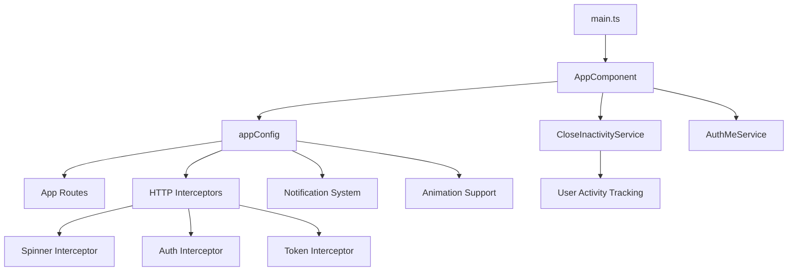

### High-Level Component Architecture

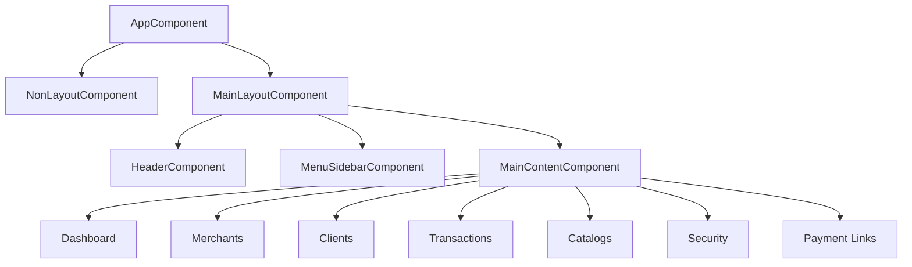

---

## Security Implementation

### Authentication & Authorization

The application implements a **multi-layered security architecture**:

#### 1. Route Guards

| Guard | Purpose | Location |
|-------|---------|----------|
| `authGuard` | Prevents authenticated users from accessing login pages | `config/guards/auth.guard.ts` |
| `nonAuthGuard` | Redirects authenticated users to dashboard | `config/guards/non-auth.guard.ts` |
| `permissionsGuard` | RBAC permission checking with retry logic | `config/guards/permissions.guard.ts` |
| `adminGuard` | Admin-only route protection | `config/guards/admin.guard.ts` |

#### Permission Guard Decision Flow

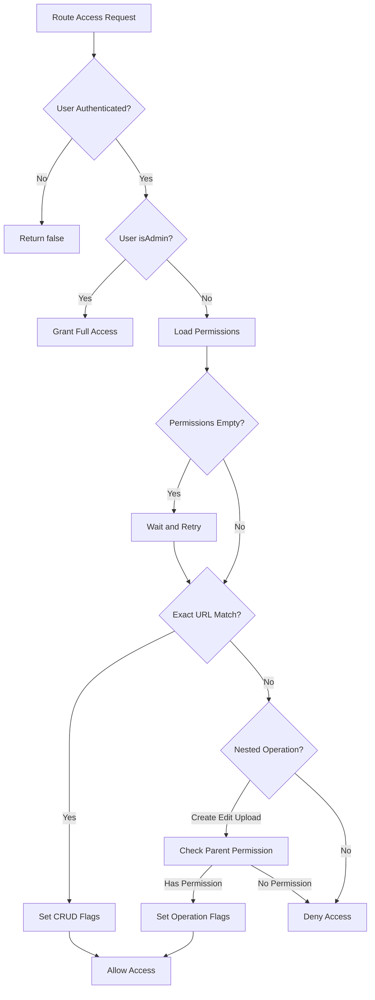

#### 2. HTTP Interceptors

| Interceptor | Priority | Function |
|-------------|----------|----------|
| `spinnerInterceptor` | 1st | Shows loading spinner on all requests |
| `authInterceptor` | 2nd | Attaches JWT Bearer token, handles auth errors |
| `tokenInterceptor` | 3rd | Proactive token refresh (1 min before expiry) |
| `userDataInterceptor` | 4th | Injects admin context for user mutations |

#### Authentication Flow

**Login Process:**

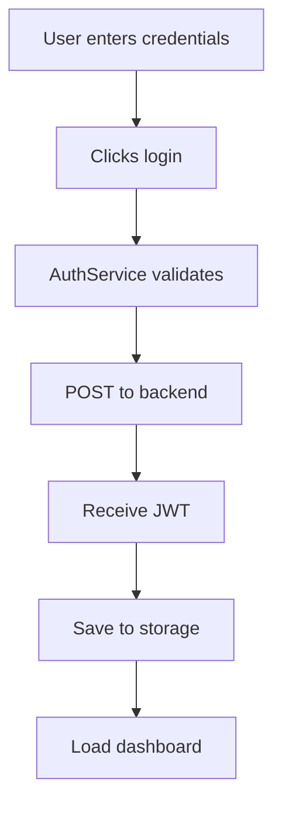

**Token Refresh on API Calls:**

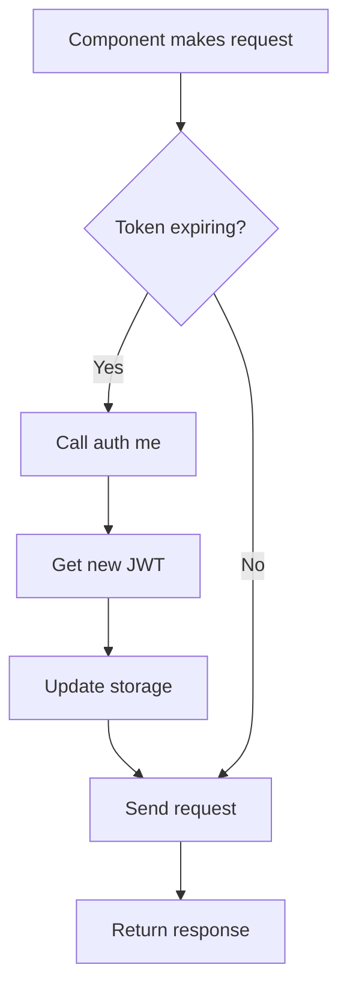

#### 3. Session Management

```typescript
// Token storage with metadata
interface TokenData {
  token: string;
  storedAt: number;      // Timestamp
  expiresAt: number;      // 5 hours from storage
}
```

**Features:**
- Dual storage strategy (`authToken` + `rawToken` fallback)
- Automatic session expiration after 5 hours
- Proactive token refresh 1 minute before expiry
- Activity-based session reset via `CloseInactivityService`

#### 4. PCI-DSS Data Protection

| Feature | Implementation |
|---------|----------------|
| Data Masking | `DataMaskerService` for card numbers |
| Secure Storage | JWT in localStorage with expiration |
| Error Handling | No sensitive data in error messages |
| HTTPS Only | All API calls use HTTPS |

---

## Core Features

### 1. Dashboard & Analytics

#### Standard Dashboard (`pages/dashboard/dashboard.component.ts`)

- **Real-time Metrics:** Transaction counts, approval rates, amounts
- **Visual Charts:** Doughnut charts for card types, account types
- **Date Filtering:** Calendar component for custom date ranges
- **Caching:** Instant loading with cached data

#### Enhanced Dashboard (`pages/dashboard/enhanced-dashboard.component.ts`)

**msg_type Filtering Logic:**

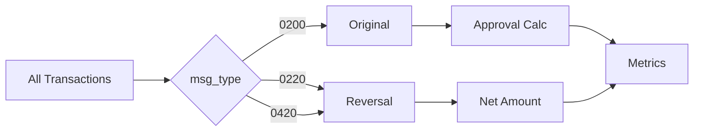

**Key Metrics:**
- **Original Transactions (0200):** Counted toward approval statistics
- **Reversals (0220/0420):** Subtracted from net amounts, not counted as approvals
- **Net Amount:** Sum(approved 0200) - Sum(approved reversals)

### 2. Transaction Management

#### Standard Transactions (`pages/movements/transactions/`)

| Feature | Description |
|---------|-------------|
| Date Range | Default: Last 24 hours |
| Pagination | 500 records per page |
| Search | Client-side filtering across all columns |
| Export | Excel (XLSX) download |
| Amount Format | Cents-to-dollars conversion (divide by 100) |

**Data Transformation Pipeline:**

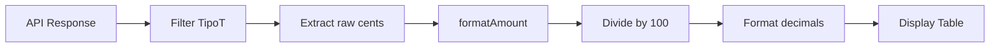

#### Enhanced Transactions (`pages/movements/transactions/enhanced-transactions.component.ts`)

- Advanced filtering and aggregation
- Detailed transaction context
- Expanded column support
- Improved performance with virtual scrolling

### 3. Merchant Management

| Component | Route | Features |
|-----------|-------|----------|
| Merchants List | `/comercios` | Search, filter, pagination |
| Merchant Detail | `/comercios/detail/:id` | View-only details |
| Merchant Form | `/comercios/create`, `/comercios/edit/:id` | Create/Edit with validation |

**Permission Integration:**
- Routes protected by `permissionsGuard`
- CRUD flags (`canEdit`, `canCreate`, `canDelete`) injected via route data
- Admin users bypass all permission checks

### 4. Payment Links (`pages/payment-links/`)

| Feature | Implementation |
|---------|----------------|
| Default Expiration | 7 days from creation |
| Merchant Filter | Only merchants with `selia_id` |
| Public Payment | Standalone payment form at `/payment` |
| Selia Integration | Direct payment processing via Selia API |

**Expiration Date Flow:**

**Setting Default Expiration:**

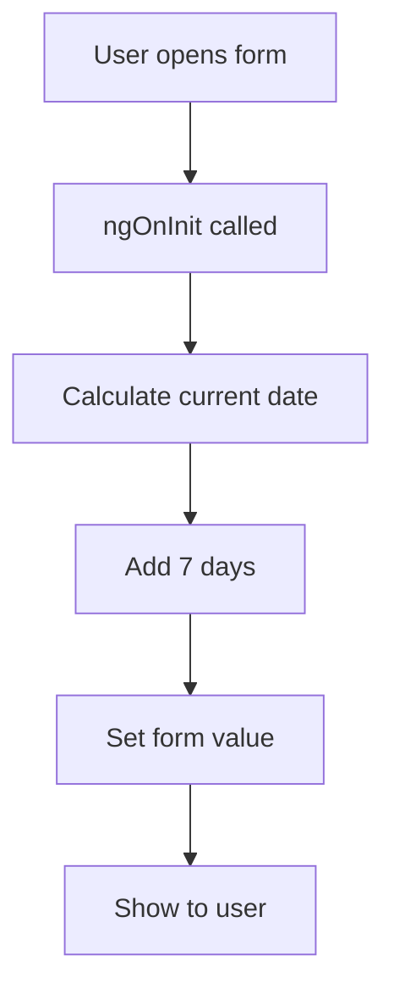

**Creating Payment Link:**

**Successful Creation:**

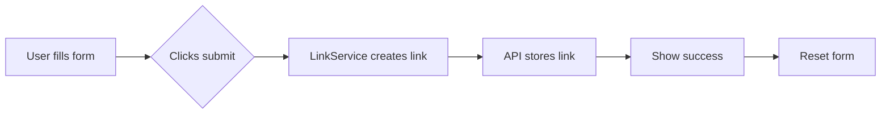

**Form Reset After Success:**

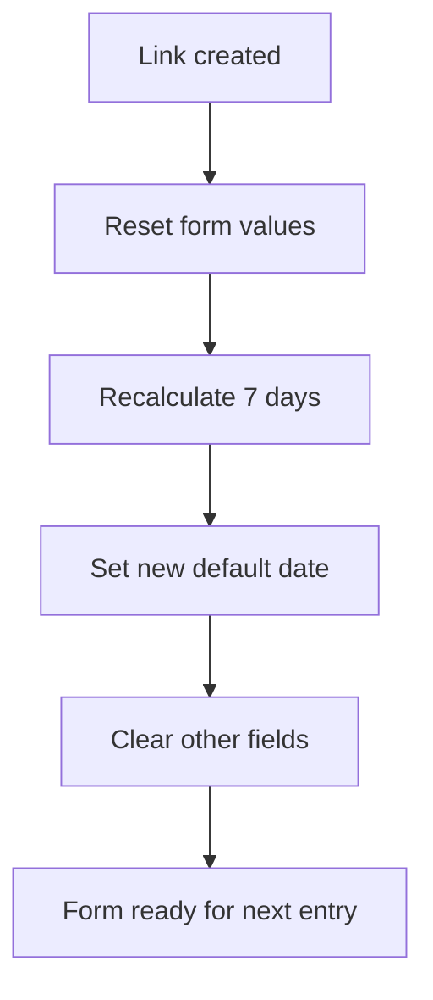

### 5. Catalog Management

**12 Catalog Types:**

| Catalog | Spanish Name | Route |
|---------|--------------|-------|
| Aggregators | Agregadores | `/catalogos/agregadores` |
| Banks | Bancos | `/catalogos/bancos` |
| Bines | Bines | `/catalogos/bines` |
| Business Types | Giros | `/catalogos/giros` |
| MCC Operations | MCC Operaciones | `/catalogos/mcc-operations` |
| Network Types | Red Lógica | `/catalogos/red-logica` |
| Person Types | Tipo de Personas | `/catalogos/tipo-de-personas` |
| Processors | Procesadores | `/catalogos/procesadores` |
| Transaction Modes | Modo Transacción | `/catalogos/modo-transaccion` |
| Transaction Schemas | Esq. Transaccional | `/catalogos/esq-transaccional` |
| Transactional Profiles | Perfil Transaccional | `/catalogos/perfil-transaccional` |
| URL Targets | URL Destino | `/catalogos/url-destino` |

**Standard CRUD Pattern:**
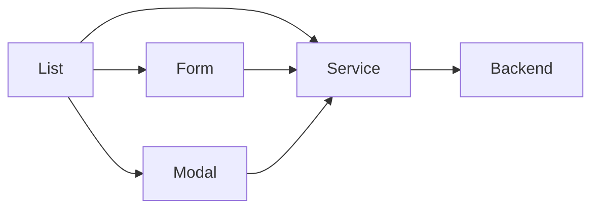

### 6. Security Management

#### Profiles (`pages/security/profiles/`)
- Role-based permission profiles
- Resource URL assignment
- CRUD permission flags (create, edit, delete, select)

#### Users (`pages/security/users/`)
- User administration
- Profile assignment
- TDM (Transaction Data Management) user support

---

## Component Inventory

### Page Components (125 total)

#### Authentication (3)
| Component | File | Description |
|-----------|------|-------------|
| Login | `pages/login/login.component.ts` | User authentication |
| Recovery Password | `pages/recovery-password/recovery-password.component.ts` | Password reset request |
| Generate Password | `pages/generate-password/generate-password.component.ts` | New password creation |

#### Dashboard (2)
| Component | File | Description |
|-----------|------|-------------|
| Dashboard | `pages/dashboard/dashboard.component.ts` | Standard dashboard |
| Enhanced Dashboard | `pages/dashboard/enhanced-dashboard/enhanced-dashboard.component.ts` | Advanced analytics |

#### Merchants (3)
| Component | File | Description |
|-----------|------|-------------|
| Merchants | `pages/merchants/merchants.component.ts` | Merchant list |
| Merchant Detail | `pages/merchants/merchant-detail/merchant-detail.component.ts` | Detail view |
| Merchant Form | `pages/merchants/new-merchant-form/new-merchant-form.component.ts` | Create/Edit |

#### Clients (3)
| Component | File | Description |
|-----------|------|-------------|
| Clients | `pages/clients/clients.component.ts` | Client list |
| Client Detail | `pages/clients/clients-detail/clients-detail.component.ts` | Detail view |
| Client Form | `pages/clients/new-client-form/new-client-form.component.ts` | Create/Edit |

#### Movements (4)
| Component | File | Description |
|-----------|------|-------------|
| Transactions | `pages/movements/transactions/transactions.component.ts` | Transaction list |
| Enhanced Transactions | `pages/movements/transactions/enhanced-transactions.component.ts` | Enhanced view |
| POS JSON | `pages/movements/pos-json/pos-json.component.ts` | POS data view |
| Tickets | `pages/movements/tickets/tickets.component.ts` | Ticket management |
| Contracharges | `pages/movements/contracharges/contracharges.component.ts` | Chargeback handling |

#### Catalogs (12 x 3 = 36 components)
Each catalog has: List, Form, (optional) Detail

#### Cards (4)
| Component | File | Description |
|-----------|------|-------------|
| Cards | `pages/cards/cards.component.ts` | Card list |
| Card Form | `pages/cards/new-card-form/new-card-form.component.ts` | Create/Edit |
| Card Detail | `pages/cards/card-detail/card-detail.component.ts` | Detail view |
| Card File Upload | `pages/cards/add-card-file/add-card-file.component.ts` | Bulk upload |

#### Devices (1)
| Component | File | Description |
|-----------|------|-------------|
| Devices | `pages/devices/devices.component.ts` | Terminal management |

#### Payment Links (4)
| Component | File | Description |
|-----------|------|-------------|
| Payment Links | `pages/payment-links/payment-links.component.ts` | Main management |
| New Payment Link | `pages/payment-links/new-payment-link/new-payment-link.component.ts` | Creation form |
| List Payment Links | `pages/payment-links/list-payment-link/list-payment-link.component.ts` | List view |
| Make Payment | `pages/payment-links/make-payment-form/make-payment-form.component.ts` | Public payment |

#### Security (3)
| Component | File | Description |
|-----------|------|-------------|
| Profiles | `pages/security/profiles/profiles.component.ts` | Permission profiles |
| Users | `pages/security/users/users.component.ts` | User management |
| Users TDM | `pages/security/users-tdm/users-tdm.component.ts` | TDM users |

#### Reports & Files (3)
| Component | File | Description |
|-----------|------|-------------|
| Reports | `pages/reports/reports.component.ts` | Report generation |
| Files | `pages/files/files.component.ts` | File management |
| Not Found | `pages/not-found/not-found.component.ts` | 404 page |

#### Admin (2)
| Component | File | Description |
|-----------|------|-------------|
| Database Explorer | `pages/admin/database-explorer/database-explorer.component.ts` | DB admin |
| Permission Tester | `admin/permission-tester/permission-tester.component.ts` | Debug tool |

### Shared Components (50+)

#### Layout (6)
| Component | File | Purpose |
|-----------|------|---------|
| Main Layout | `shared/components/main-layout/main-layout.component.ts` | App shell wrapper |
| Non Layout | `shared/components/non-layout/non-layout.component.ts` | Public page layout |
| Menu Sidebar | `shared/components/menu-sidebar/menu-sidebar.component.ts` | Dynamic navigation |
| Header | `shared/components/header/header.component.ts` | Top navigation |
| Main Content | `shared/components/main-content/main-content.component.ts` | Content area wrapper |
| Footer | `shared/components/footer/footer.component.ts` | Page footer |

#### Form Inputs (12+)
| Component | File | Purpose |
|-----------|------|---------|
| Input Text | `shared/components/input-text/input-text.component.ts` | Text input |
| Input Number | `shared/components/input-number/input-number.component.ts` | Numeric input |
| Input Select | `shared/components/input-select/input-select.component.ts` | Dropdown |
| Input Textarea | `shared/components/input-textarea/input-textarea.component.ts` | Multi-line text |
| Calendar | `shared/components/calendar/calendar.component.ts` | Date picker |
| Annual Calendar | `shared/components/annual-calendar/annual-calendar.component.ts` | Year view |
| Input Radial | `shared/components/input-radial/input-radial.component.ts` | Radio buttons |

#### Data Display (10+)
| Component | File | Purpose |
|-----------|------|---------|
| Table Layout | `shared/components/table-layout/table-layout.component.ts` | Data table |
| Basic Table | `shared/components/basic-table/basic-table.component.ts` | Simple table |
| Table Paginator | `shared/components/table-paginator/table-paginator.component.ts` | Pagination |
| Table Footer | `shared/components/table-footer/table-footer.component.ts` | Table footer |
| Card Container | `shared/components/card-container/card-container.component.ts` | Card wrapper |
| Form Card | `shared/components/form-card/form-card.component.ts` | Form section |

#### Charts (3)
| Component | File | Purpose |
|-----------|------|---------|
| Donut Chart | `shared/components/donut-chart/donut-chart.component.ts` | Doughnut visualization |
| Card Donut Chart | `shared/components/card-dounut-chart/card-dounut-chart.component.ts` | Chart in card |
| Bar Chart | `shared/components/bar-chart/bar-chart.component.ts` | Bar visualization |

#### UI Elements (20+)
| Component | File | Purpose |
|-----------|------|---------|
| Spinner | `shared/components/spinner/spinner.component.ts` | Loading indicator |
| Modal Confirm | `shared/components/modal-confirm/modal-confirm.component.ts` | Confirmation dialog |
| Modal Content | `shared/components/modal-content/modal-content.component.ts` | Modal wrapper |
| Action Button | `shared/components/action-button/action-button.component.ts` | Action buttons |
| Default Button | `shared/components/default-button/default-button.component.ts` | Standard buttons |
| Float Button | `shared/components/float-button/float-button.component.ts` | FAB |
| Search Bar | `shared/components/search-bar/search-bar.component.ts` | Global search |
| Section Title | `shared/components/section-title/section-title.component.ts` | Section headers |
| Text Title | `shared/components/text-title/text-title.component.ts` | Typography |
| User Profile Badge | `shared/components/user-profile-badge/user-profile-badge.component.ts` | User avatar |

---

## Service Layer

### Authentication Services (4)

| Service | File | Methods | Description |
|---------|------|---------|-------------|
| AuthService | `services/auth/auth.service.ts` | `login()`, `logout()`, `storeToken()`, `getToken()`, `isAutenticated()`, `userInfo` | Core authentication |
| AuthMeService | `services/auth/auth-me/auth-me.service.ts` | `getMe()` | Current user retrieval |
| AuthResetService | `services/auth/auth-reset/auth-reset.service.ts` | `resetPassword()` | Password reset flow |
| NewAuthService | `services/auth/new-auth/new-auth.service.ts` | Alternative auth | Secondary auth implementation |

### Catalog Services (12)

All located in `services/catalogues/`:

| Service | File | Endpoints |
|---------|------|-----------|
| AgregatorsService | `agregators/agregators.service.ts` | `/catalogues/aggregators` |
| BanksService | `banks/banks.service.ts` | `/catalogues/banks` |
| BinesService | `bines/bines.service.ts` | `/catalogues/bines` |
| BusinessService | `business/business.service.ts` | `/catalogues/business` |
| LogicalNetworksService | `logical-networks/logical-networks.service.ts` | `/catalogues/logical-networks` |
| MCCOperationsService | `mcc-operations/mcc-operations.service.ts` | `/catalogues/mcc-operations` |
| MerchantCategoryCodesService | `merchant-category-codes/merchant-category-codes.service.ts` | `/catalogues/mcc` |
| PersonTypesService | `person-types/person-types.service.ts` | `/catalogues/person-types` |
| ProcessorsService | `processors/processors.service.ts` | `/catalogues/processors` |
| TargetUrlsService | `target-urls/target-urls.service.ts` | `/catalogues/target-urls` |
| TransactionModeService | `transaction-mode/transaction-mode.service.ts` | `/catalogues/transaction-modes` |
| TransactionProfilesService | `transaction-profiles/transaction-profiles.service.ts` | `/catalogues/transaction-profiles` |
| TransactionalSchemasService | `transactional-schemas/transactional-schemas.service.ts` | `/catalogues/transactional-schemas` |
| UrlTargetService | `url-target/url-target.service.ts` | `/catalogues/url-targets` |

### Movement Services (6)

| Service | File | Key Features |
|---------|------|--------------|
| TransactionsService | `movements/transactions/transactions.service.ts` | Standard transaction CRUD, pagination |
| EnhancedTransactionsService | `movements/enhanced-transactions/enhanced-transactions.service.ts` | Advanced filtering, aggregation |
| POSJsonService | `movements/posjson/posjson.service.ts` | POS data retrieval |
| TicketsService | `movements/tickets/tickets.service.ts` | Ticket management |
| ContrachargesService | `movements/contracharges/contracharges.service.ts` | Chargeback handling |
| MovementsDetailService | `movements/movements-detail/movements-detail.service.ts` | Detail queries |

### Security Services (3)

| Service | File | Purpose |
|---------|------|---------|
| ProfilesService | `security/profiles/profiles.service.ts` | Profile CRUD, permission assignment |
| UsersService | `security/users/users.service.ts` | User management |
| UsersTDMService | `security/usersTDM/users-tdm.service.ts` | TDM user operations |

### Shared Services (15+)

| Service | File | Purpose |
|---------|------|---------|
| SharedService | `shared/shared.service.ts` | Global state (BehaviorSubjects) |
| ActivityService | `activity.service.ts` | Audit logging |
| CloseInactivityService | `shared/close-inactivity/close-inactivity.service.ts` | Session timeout |
| DataMaskerService | `shared/data-masker/data-masker.service.ts` | PCI data masking |
| ErrorMessageService | `shared/error-message/error-message.service.ts` | Error handling |
| SearchService | `shared/search/search.service.ts` | Global search |
| SpinnerService | `shared/spinner/spinner.service.ts` | Loading state |
| FormDataService | `shared/form-data/form-data.service.ts` | Form utilities |
| FormTrimService | `shared/form-trim/form-trim.service.ts` | Input trimming |
| CountriesService | `shared/countries-service/countries.service.ts` | Country data |
| PersonTypeService | `shared/personType/person-type.service.ts` | Person type utilities |

### Entity Services (4)

| Service | File | Entity |
|---------|------|--------|
| MerchantsService | `merchants/merchants.service.ts` | Merchants |
| ClientsService | `clients/clients.service.ts` | Clients |
| DevicesService | `devices/devices.service.ts` | Terminals |
| FilesService | `files/files.service.ts` | File management |
| LinkService | `links/link.service.ts` | Payment links |
| ReportsService | `reports/reports.service.ts` | Reports |
| AboutService | `about/about.service.ts` | App info |
| BinesService | `bines/bines.service.ts` | Card bins |
| DatabaseExplorerService | `admin/database-explorer/database-explorer.service.ts` | DB admin |

---

## Data Models

### Core Interfaces (34+)

#### Authentication
```typescript
// login-response.interface.ts
interface LoginResponseInterface {
  token: string;
  license: any;
  user: {
    id: number;
    username: string;
    fullName: string;
    mail: string;
    id_profile: number;
    is_admin: number;
    id_cliente?: number;
    telephone?: string;
    name?: string;
    last_name?: string;
  }
}

// user-info.interface.ts
interface UserInfo {
  fullName: string;
  mail: string;
  userProfile: number;
  username: string;
  isAdmin: boolean;
  idClient?: number;
  telephone?: string;
  name?: string;
  last_name?: string;
}
```

#### Menu & Permissions
```typescript
// menu-sidebar.interface.ts
interface AnyMenuItem {
  resource_name: string;
  resource_url: string;
  create: number;
  edit: number;
  delete: number;
  select: number;
  parent_resource_id?: number;
  id?: number;
}

interface MenuSidebar extends AnyMenuItem {
  subItems?: AnyMenuItem[];
  isOpen?: boolean;
  icon?: string;
}
```

#### Merchant
```typescript
// merchants.interface.ts
interface MerchantsInterface {
  id_merchant: number;
  merchantName: string;
  merchantBusinessName?: string;
  idClient: number;
  idAggregator: number;
  idProcessor: number;
  idMCC: number;
  idBusinessType: number;
  // ... 50+ fields
}
```

#### Transaction
```typescript
// movements/transactions/transactions.ts
interface MovementsAllInterface {
  Fecha: string;
  Hora: string;
  Cliente: string;
  Comercio: string;
  Afiliación: string;
  Tarjeta: string;
  TipoProd: string;
  Estatus: string;
  EstatusF: string;
  Método: string;
  Terminal: string;
  TipoT: string;
  Monto: number;
  // ... 30+ fields
}
```

#### Payment Links
```typescript
// payment-links.interface.ts
interface PaymentLinkInterface {
  id_link: number;
  linkToken: string;
  id_merchant: number;
  amount: number;
  expirationDate: string;
  description?: string;
  reference?: string;
  status: 'active' | 'expired' | 'used';
}
```

---

## Routing Structure

### Route Hierarchy

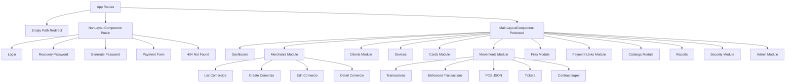

### Route Configuration Pattern

```typescript
{
  path: 'comercios',
  loadComponent: () => import('./pages/merchants/merchants.component')
    .then(c => c.MerchantsComponent),
  canActivate: [permissionsGuard]
},
{
  path: 'comercios/create',
  loadComponent: () => import('./pages/merchants/new-merchant-form/new-merchant-form.component')
    .then(c => c.NewMerchantFormComponent),
  canActivate: [permissionsGuard]
}
```

### Lazy Loading

All feature modules use lazy loading via `loadComponent()`:
- Reduces initial bundle size
- Loads components on-demand
- Improves application startup performance

---

## Performance Optimizations

### 1. Component Loading
- **Lazy Loading:** All feature components loaded on-demand
- **Standalone Components:** Angular 14+ standalone architecture
- **Tree-shakeable:** Unused components excluded from bundle

### 2. Data Handling
- **Pagination:** 500 records per page (configurable)
- **Client-side Filtering:** Search filters applied to loaded data
- **Caching:** Dashboard metrics cached for instant loading
- **RxJS:** Reactive streams with proper unsubscribe patterns

### 3. Build Optimizations
```json
{
  "optimization": {
    "scripts": true,
    "styles": true,
    "fonts": false
  },
  "outputHashing": "all",
  "budgets": [
    {"type": "initial", "maximumWarning": "2mb", "maximumError": "3mb"}
  ]
}
```

### 4. Memory Management
- `takeUntil(this.destroy$)` pattern for subscription cleanup
- Component-level change detection with `ChangeDetectorRef`
- BehaviorSubjects properly completed on service destruction

---

## Development Guide

### Prerequisites

```bash
# Node.js version
node --version  # Requires ^20.12.2

# Install dependencies
npm install
```

### Development Server

```bash
# Start development server with proxy
npm run serve

# Application available at http://localhost:4200
```

### Build

```bash
# Production build
npm run build

# Output: dist/Taakpay/
```

### Project Structure

```
gw-frontend-backup/
├── src/
│   ├── app/
│   │   ├── activity-list/          # Audit log viewer
│   │   ├── admin/                  # Admin utilities
│   │   ├── app.component.ts        # Root component
│   │   ├── app.config.ts           # App configuration
│   │   ├── app.routes.ts           # Route definitions
│   │   ├── config/                 # Guards & interceptors
│   │   ├── pages/                  # Feature modules
│   │   ├── permissions-manager/    # Permission UI
│   │   ├── services/               # API services
│   │   ├── shared/                 # Components, interfaces, pipes
│   │   └── utils/                  # Utility functions
│   ├── assets/                     # Static assets
│   └── environments/               # Environment configs
├── angular.json                    # Angular CLI config
├── package.json                    # Dependencies
└── tailwind.config.js              # Tailwind CSS config
```

### API Configuration

Base URL configured in `src/environments/environment.ts`:
```typescript
export const environment = {
    production: true,
    apiUrl: '/gateway'
};
```

### Adding a New Feature

1. Create service in `services/[feature]/`
2. Create interface in `shared/interfaces/[feature].interface.ts`
3. Create page component in `pages/[feature]/`
4. Add routes in `app.routes.ts`
5. Apply `permissionsGuard` for protected routes
6. Register in menu sidebar icons

---

## PCI-DSS Compliance Notes

### Requirement 4.1 - Strong Cryptography and Security Protocols

| Aspect | Implementation | Location |
|--------|------------------|----------|
| **4.1 - TLS 1.2+ for all transmissions** | HTTPS enforced for all API communication | `environment.ts` - API base URL uses HTTPS |
| **4.1.1 - Strong cipher suites** | Configured at server/load balancer level | AWS ALB/CloudFront TLS policy |
| **4.1.2 - No insecure protocols** | No HTTP fallback, no SSL 2.0/3.0, no TLS 1.0/1.1 | Angular HttpClient forces HTTPS |
| **4.1.3 - Certificate validation** | Browser-enforced certificate chain validation | Built into browser security |
| **4.1.4 - Encrypted session tokens** | JWT tokens transmitted over HTTPS only | `auth.interceptor.ts` |
| **4.1.5 - No sensitive data in URL** | All auth tokens in headers, never in query params | `AuthInterceptor` - Bearer header |

**Transmission Security Flow:**

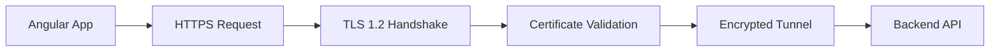

### Other Requirements

| Requirement | Implementation |
|-------------|----------------|
| 3.4 - Render PAN unreadable | `DataMaskerService` masks card numbers (showing only last 4 digits) |
| 8.1 - User identification | JWT-based authentication with unique user identifiers |
| 8.2 - User authentication | Password-based login with secure token storage |
| 8.3 - Multi-factor authentication | Supported at backend level |
| 10.1 - Audit trails | `ActivityService` logs all user actions |
| 10.2 - Audit trail coverage | Captures user ID, timestamp, action type, resource |
| 12.3 - Data security policy | Session timeout after 5 hours + inactivity detection |

---

## License

Proprietary - All rights reserved.

This software is the proprietary and confidential property of Taakpay. Unauthorized copying, distribution, or use of this software is strictly prohibited.

**Copyright © 2024-2026 Taakpay. All rights reserved.**

---

## Support & Documentation

### Internal Documentation
- `pre-readme.md` - Analysis plan with task checklist
- `docs/` - Additional feature documentation
- Component-level JSDoc comments

### External References
- Angular Docs: https://angular.io/docs
- PrimeNG Docs: https://primeng.org/documentation
- TailwindCSS: https://tailwindcss.com/docs

---

*Document Version: 1.0*  
*Last Updated: April 17, 2026*  
